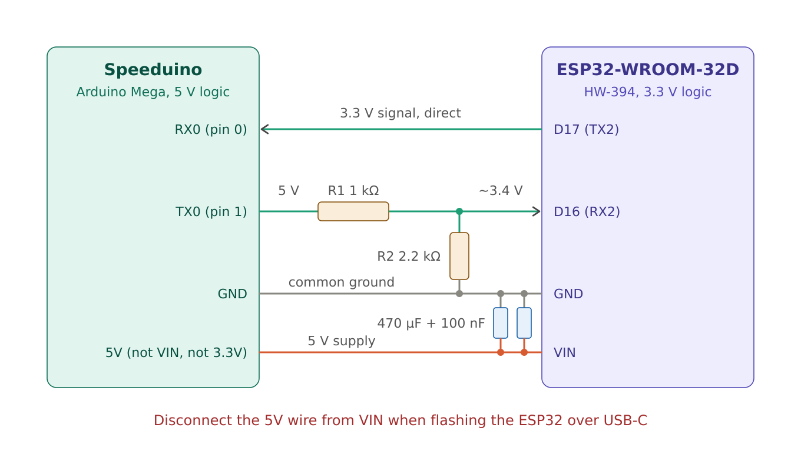
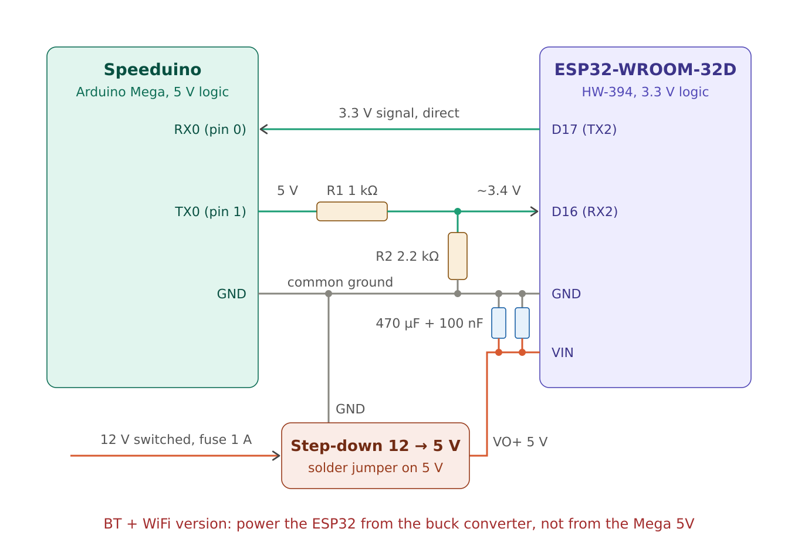

# ESP32-WROOM-32 Speeduino wireless bridge

Wireless connection to a [Speeduino](https://speeduino.com) ECU based on an Arduino Mega 2560, using a classic ESP32 dev board as a transparent serial bridge. TunerStudio on a laptop, or a dashboard app on a phone, connects to the ESP32, and the ESP32 forwards everything to the Speeduino over UART.

This replaces the usual HC-05 / HC-06 modules, which tend to be unreliable at 115200 baud: small buffers, clones with inconsistent firmware, and frequent dropouts.

## Two versions

| | **Bluetooth** | **Bluetooth + WiFi** |
|---|---|---|
| Sketch | [`speeduino_bt/`](speeduino_bt/speeduino_bt.ino) | [`speeduino_bt_wifi/`](speeduino_bt_wifi/speeduino_bt_wifi.ino) |
| Connection | Bluetooth Classic (SPP) | Bluetooth Classic (SPP) **or** WiFi access point + TCP server |
| Power | from the Mega **5V** pin | separate **12 V → 5 V buck converter** |
| Current draw | ~100–150 mA, peaks ~250 mA | peaks up to ~500 mA |
| Laptop setup (Linux) | pair + `rfcomm bind` | just join the WiFi network |
| iPhone | ✗ (iOS has no Bluetooth SPP) | ✓ over WiFi |
| Phone keeps internet | ✓ | ✗ while connected to the ESP32 WiFi |
| Partition scheme | default (Huge APP if too big) | **Huge APP (3MB No OTA)** |
| Best for | Android / Linux, simplest wiring | iPhone, slightly lower latency, no pairing |

**Not sure? Start with the Bluetooth version.** It is simpler to wire and runs from the Speeduino's own 5 V. Switch to BT + WiFi if you need an iPhone or prefer not to deal with Bluetooth pairing. Only the sketch and the power wiring change, the signal wiring stays the same.

## Hardware

| Part | Notes |
|---|---|
| ESP32-WROOM-32 / 32D dev board | Must be the **classic ESP32**. ESP32-S3, C3, C5, C6 and H2 only have BLE and do **not** support Bluetooth Classic (SPP). Tested with an HW-394 (USB-C, CH340) board. |
| Speeduino (Arduino Mega 2560) | Original Mega or a CH340 clone both work. |
| R1 1 kΩ, R2 2.2 kΩ (or 2 kΩ) | Voltage divider: 5 V TX from the Mega → ~3.4 V for the ESP32 RX. |
| 470 µF electrolytic (≥ 10 V) + 100 nF ceramic | Decoupling close to the ESP32 VIN/GND pins. |
| *BT + WiFi only:* mini 12 V → 5 V buck converter | E.g. a fixed-output module with a solder jumper set to **5 V**, plus a 1 A fuse on its input. |

## Wiring

The signal wiring is the same for both versions:

| Speeduino / Mega | ESP32 | Notes |
|---|---|---|
| TX0 (pin 1) | GPIO16 / D16 (RX2) | **Through the divider:** R1 1 kΩ in series, R2 2.2 kΩ from GPIO16 to GND |
| RX0 (pin 0) | GPIO17 / D17 (TX2) | Direct. The Mega reads 3.3 V as logic high. |
| GND | GND | Required, the common ground is mandatory. |

Power is the only difference:

| Version | ESP32 VIN connects to |
|---|---|
| Bluetooth | Mega **5V** pin. **Not** the Mega VIN pin (raw 12–14 V in a car) and **not** the 3.3V pin (only ~50 mA). |
| BT + WiFi | **VO+** of the buck converter (5 V). Buck GND to common ground, buck IN+ to switched 12 V through a 1 A fuse. |

### Bluetooth version: powered from the Mega



### BT + WiFi version: powered from a buck converter



### Important notes

- **Use the Mega's primary serial (pins 0/1).** TunerStudio only works on Serial0. The secondary serial (Serial3, pins 14/15) uses a different protocol (e.g. RealDash) and will not work with TunerStudio.
- **Use GPIO16/17 on the ESP32, not TX0/RX0.** UART0 on the ESP32 is connected to the on-board USB chip and prints boot messages.
- **A DC-DC buck converter can't be used as a level shifter.** It only works for power. For the signal, use the resistor divider or a BSS138-based level shifter module.
- **Measure the buck converter output before connecting the ESP32.** Make sure only the 5 V solder jumper is bridged.
- **Keep the 470 µF + 100 nF capacitors close to the ESP32** to avoid brownout resets (`Brownout detector was triggered`) and noise on the Speeduino's 5 V sensor reference. If TPS/MAP readings get noisier with the Bluetooth version, move to the buck converter.
- **Do not power the ESP32 from USB-C and VIN at the same time.** Disconnect the VIN wire while flashing the ESP32.

### USB and the ESP32 on the same port

Both the Mega's USB chip and the ESP32 drive RX0. With the ESP32 connected, commands from USB won't reach the Mega reliably, and **flashing the Speeduino firmware over USB will fail**. Two options:

1. **Switch / jumper** in the ESP32 TX2 → Mega RX0 wire. Open it for USB, close it for wireless.
2. **Diode (wired-AND):** put a Schottky diode (BAT85, BAT43, 1N5819; a 1N4148 also works) in that wire, with the **cathode (stripe) towards the ESP32** and the anode towards RX0. The ESP32 can then only pull RX0 low, and the USB chip's 1 kΩ resistor keeps the line high when idle. USB and wireless both work without switching. Only use one connection at a time.

The TX0 → divider → GPIO16 line can stay connected in both cases.

## Flashing the ESP32

1. Arduino IDE → Boards Manager → install **esp32 by Espressif Systems**.
2. Board: **ESP32 Dev Module**.
3. Tools → Partition Scheme → **Huge APP (3MB No OTA)**. Required for BT + WiFi; for the Bluetooth version only if you get `Sketch too big`.
4. Open `speeduino_bt/speeduino_bt.ino` **or** `speeduino_bt_wifi/speeduino_bt_wifi.ino` and upload. If it hangs on `Connecting...`, hold the **BOOT** button until the upload starts.
5. Open the Serial Monitor at 115200 baud and check the startup message:
   - Bluetooth: `Bluetooth running as "Speeduino"`
   - BT + WiFi: additionally `WiFi AP "Speeduino", TCP 192.168.4.1:2000`

On Linux the CH340 shows up as `/dev/ttyUSB0`. Your user needs to be in the `uucp` (Arch) or `dialout` (Debian/Ubuntu) group.

### Settings in the BT + WiFi sketch

```cpp
#define BT_NAME   "Speeduino"
#define WIFI_SSID "Speeduino"
#define WIFI_PASS "speeduino123"   // WPA2, at least 8 characters - change it!
#define TCP_PORT  2000
```

**Change the WiFi password** before installing it in the car.

## Connecting

### Bluetooth: Linux (TunerStudio)

```bash
bluetoothctl        # scan on, pair <MAC>, trust <MAC>, quit
sudo rfcomm bind 0 <MAC> 1
```

In TunerStudio, use port `/dev/rfcomm0` at **115200** baud. If the port is not listed, type it in manually.

### Bluetooth: Android

Pair with the **Speeduino** device in Android settings, then select it in your dashboard / logging app.

### WiFi (BT + WiFi version)

1. Connect the laptop or phone to the WiFi network **Speeduino** with your password.
2. In TunerStudio, choose the TCP/IP (WiFi) connection type with IP **192.168.4.1** and port **2000**. The exact menu name depends on the TunerStudio version.
3. In a dashboard app that supports TCP (e.g. RealDash), use the same IP and port.

The ESP32 accepts one TCP client at a time. A new client replaces the old one.

> **Use only one connection at a time.** Bluetooth and WiFi both reach the same Speeduino serial port. If two apps talk to it at once, their data gets mixed up.

## Testing step by step

1. **ESP32 only:** disconnect the Mega and bridge GPIO16 to GPIO17 on the ESP32. Connect from a phone with *Serial Bluetooth Terminal* (Bluetooth) or a TCP terminal app (WiFi) and type something. If it echoes back, the ESP32 side works.
2. **Mega link:** reconnect the Mega and temporarily add a debug print after the `Serial2.readBytes(...)` line:
   ```cpp
   if (n) Serial.printf("From Speeduino: %u B\n", n);
   ```
   If bytes arrive when TunerStudio connects, the Mega answers and any problem is on the PC side. If nothing arrives, check wiring, swapped TX/RX, the divider and the common ground.

## Installation in the car

- A **plastic** enclosure is fine. Inside a **metal** box the signal will be badly attenuated: put the ESP32 in its own plastic box outside it, or use an **ESP32-WROOM-32U** with an external antenna. The code is the same.
- Point the PCB antenna (the zig-zag trace end of the module) towards the windshield and keep wires, screws and the Mega board 1–2 cm away from it.
- The area under the windshield (plenum) gets wet: seal the enclosure and route the wires in from below.
- Test with the hood closed from the driver's seat before final installation.

## Performance

The bottleneck is the Speeduino's 115200 baud UART, not the radio. Approximate logging rates (depend on firmware, channel count and TunerStudio):

| Link | Round-trip latency | Approx. log rate |
|---|---|---|
| USB cable | ~1–2 ms | ~25–40 samples/s |
| ESP32 WiFi (TCP) | ~3–10 ms | ~20–35 samples/s |
| ESP32 Bluetooth | ~10–30 ms | ~15–25 samples/s |
| HC-05 / HC-06 | ~20–50 ms, varies | ~10–20 samples/s, frequent dropouts |

15–20 samples/s is enough for VE / AFR / ignition tuning.

## Security

- **Bluetooth:** neither sketch sets a PIN, so any device can connect. A device connected via TunerStudio can rewrite the tune. For permanent installation, consider adding a MAC address whitelist (`BT.register_callback()` + `ESP_SPP_SRV_OPEN_EVT`, disconnecting unknown addresses). `BT.setPin()` only works with legacy pairing and is ignored by many phones that use Secure Simple Pairing.
- **WiFi:** protected by WPA2. Use a strong password of your own instead of the default.
